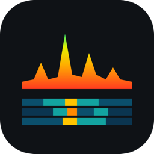
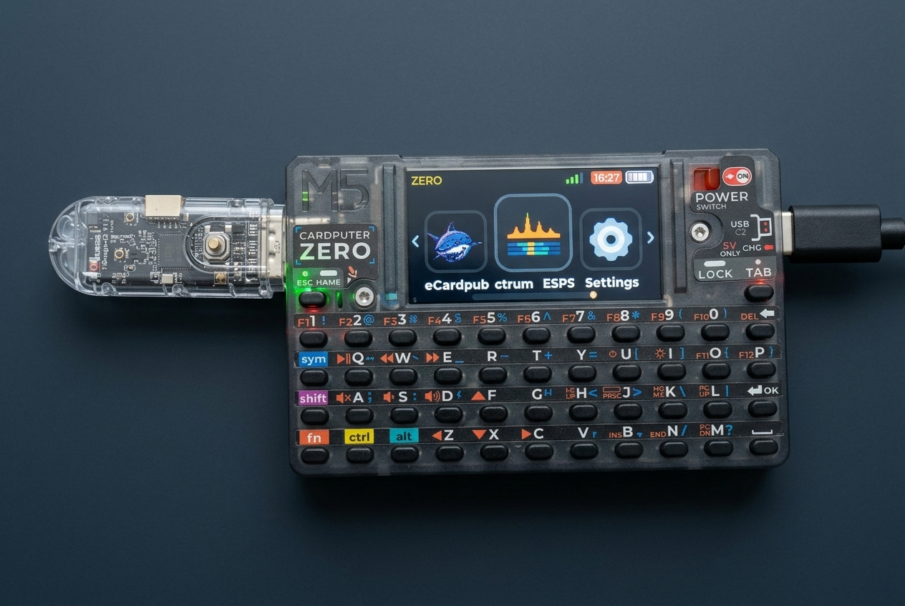
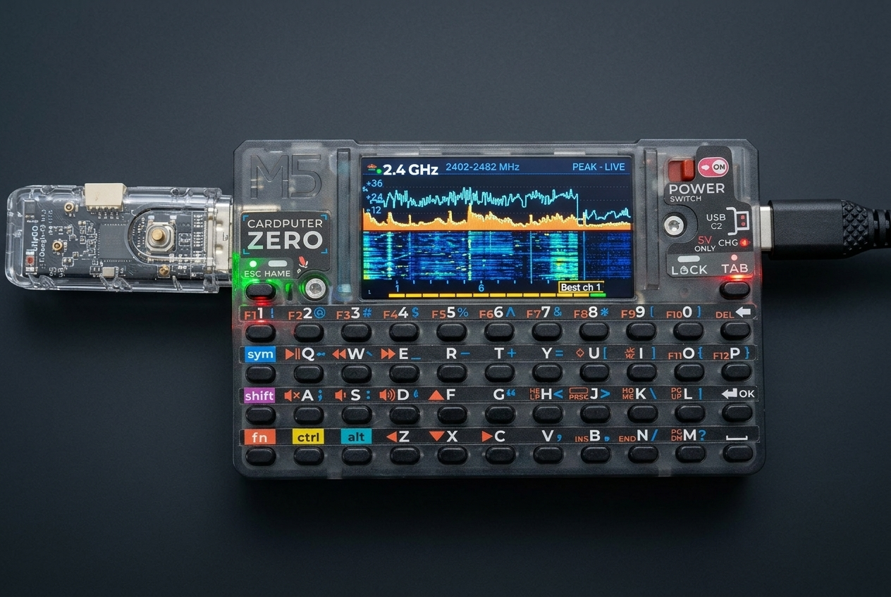
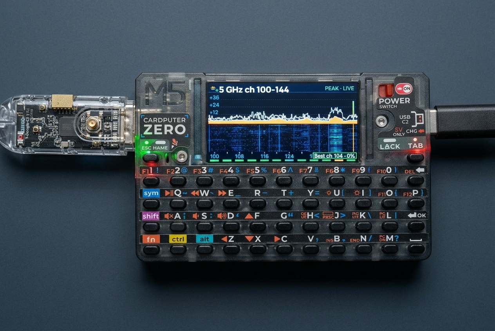
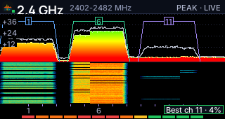
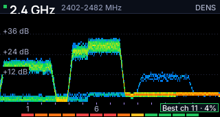
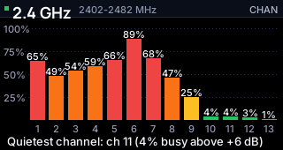

<p align="center">
  
</p>

<h1 align="center">esp32c5-spectrum-cardputer</h1>

<p align="center">
  <b>Your pocket Wi-Fi spectrum analyser, now on the M5Stack CardputerZero.</b><br>
  Plug an ESP32-C5 board into the side USB port. 2.4 and 5 GHz, live trace, waterfall, density and channel scorecard.
</p>

<p align="center">
  <a href="https://jamesjulier.github.io/esp32c5-spectrum/#firmware"><b>Flash an ESP32-C5 board</b></a> ·
  <a href="https://github.com/jamesjulier/esp32c5-spectrum"><b>Main esp32c5-spectrum repo</b></a> ·
  <a href="#how-to-use-it">How to use it</a> ·
  <a href="#keyboard-controls">Keyboard controls</a>
</p>

<p align="center">
  <a href="LICENSE"></a>
  
  
  
</p>

<p align="center">
  
</p>

<p align="center">
  
  
</p>

## What is it?

Your Wi-Fi scanner tells you which networks are around. It doesn't tell you about the microwave
in the kitchen, the video sender in the corner, or the cheap camera hammering channel 6. This does.

It is the native **M5Stack CardputerZero** companion app for
[**esp32c5-spectrum**](https://github.com/jamesjulier/esp32c5-spectrum). Plug an ESP32-C5 dev board
(or a tiny USB stick like the **LilyGO T-Dongle-C5** or **Seeed XIAO ESP32-C5**) into the
CardputerZero's side USB port and you get a proper handheld 2.4 GHz and 5 GHz RF spectrum analyser
with a physical keyboard.

It shows **all** the radio energy across 2.4 and 5 GHz, Wi-Fi or not, with the Wi-Fi channels
marked underneath, so you can see what's actually sharing the air with your network.

The clever bit isn't mine: [ESP-SDR](https://github.com/ESPARGOS/esp-sdr) by Florian Euchner
(ESPARGOS) worked out how to read raw IQ / FFT samples from the ESP32-C5's own dual-band Wi-Fi 6
receiver. I gave it a screen, buttons, a browser app, and now a native Linux framebuffer app for the
CardputerZero.

## What you're looking at

<p align="center">
  
</p>

- **The trace** is the level right now: red at the noise floor, green on strong signals (+36 dB).
  Wi-Fi shows up as a hump about 20 MHz wide. A narrow spike is usually something that isn't Wi-Fi
  (Bluetooth, Zigbee, wireless mice or video senders).
- **The grey line** is peak hold, the highest level seen so far.
- **The waterfall** is history, newest at the top. Solid colour is something that never stops,
  flecks are bursts of traffic.
- **The channel scorecard** along the bottom colours each channel by how busy it was and names the
  quietest one (for example `Best ch 11 · 4%`).

| **Density**: how often each level turns up | **Channels**: how busy each Wi-Fi channel is |
|---|---|
|  |  |

The lowest bar on **Channels** is your quietest channel. That's usually the one to pick.

Levels are in **dB above the noise floor**, not dBm. The receiver's gain isn't calibrated, so the
numbers are good for comparing signals, not for measuring exactly how strong they are.

## How to use it

### 1. Put the firmware on an ESP32-C5 board (once)

1. Open **https://jamesjulier.github.io/esp32c5-spectrum/#firmware** in Chrome or Edge on your
   computer.
2. Pick your board (**Waveshare ESP32-C5-LCD-1.47**, **Waveshare ESP32-C5-Touch-LCD-2.8**,
   **LilyGO T-Dongle-C5**, or **Seeed XIAO ESP32-C5**), plug it in and click **Flash**. Half a
   minute later it's done.

### 2. Install the app on your CardputerZero

- **From the CardputerZero AppStore**: search for **ESP32-C5 Spectrum** or type the share code
  **`C5SP`**.
- **Or install the `.deb` over Wi-Fi / SSH**:
  ```bash
  scp esp32c5-spectrum_0.1.0-m5stack1_arm64.deb pi@<cardputer-ip>:/tmp/
  ssh pi@<cardputer-ip> "sudo dpkg -i /tmp/esp32c5-spectrum_0.1.0-m5stack1_arm64.deb"
  ```

### 3. Plug the board into the side USB port

1. Open **ESP32-C5 Spectrum** from the CardputerZero launcher.
2. Plug your ESP32-C5 board into the CardputerZero's side USB port (via a USB-A to USB-C adapter or
   directly with a LilyGO T-Dongle-C5).
3. The app automatically discovers `/dev/ttyACM*` / `/dev/ttyUSB*`, asks the board who it is (`ID?`),
   and starts sweeping. If your board has its own screen, it says **PHONE CONNECTED** while the
   CardputerZero has the radio, and goes back to its own display 10 seconds after you unplug or exit.

No board handy? Press **`D`** at any time to run the built-in **Demo Simulator**.

## Keyboard controls

| Key | What it does |
|---|---|
| `1` – `4` or `Tab` | Switch band: **2.4 GHz** (2402–2482 MHz), **5 GHz ch 36–64**, **5 GHz ch 100–144**, **5 GHz ch 149–165** |
| `V` or `M` | Cycle view: **Live + Waterfall** → **Density** → **Channels** |
| `←` / `→` (or `,` / `.`) | Move the frequency cursor to read MHz, nearest Wi-Fi channel and dB (`Shift` for fast step) |
| `Z` or `Enter` | Zoom to a 40 MHz window around the cursor's Wi-Fi channel, and press again to zoom out |
| `O` | Show or hide Chanalyzer-style Wi-Fi channel spectral masks |
| `P` | Peak hold line on or off |
| `A` | Long average line on or off |
| `Space` | Freeze or unfreeze the trace |
| `C` | Clear history and peak hold |
| `D` | Toggle Demo Simulator mode |
| `H` or `/` | Show or hide the on-screen keyboard guide |
| `Esc` or `Q` | Clear cursor, zoom out, or quit back to the CardputerZero launcher |

There are two easter eggs in the app. One of them involves your microwave (`microwave`), and the
other involves an old oscilloscope.

## Supported ESP32-C5 boards

| Board | Form factor | Notes with CardputerZero |
|---|---|---|
| **LilyGO T-Dongle-C5** | USB-A stick | Plugs straight into the CardputerZero's side USB-A port with no cable |
| **Seeed XIAO ESP32-C5** | Thumb-sized USB-C | Tiny, cheap, and draws next to nothing over a short USB-A to USB-C adapter |
| **Waveshare ESP32-C5-LCD-1.47** | USB-A / USB-C | Works standalone on its own screen, or hands over the radio when plugged in |
| **Waveshare ESP32-C5-Touch-LCD-2.8** | USB-C | Full standalone touch analyser that also works as a USB radio for CardputerZero |

## Worth knowing

- **It only listens.** Nothing is transmitted once it's running, though the ESP32-C5 radio chip may
  make a tiny internal calibration blip as it powers up.
- **Levels are relative (`dB above the noise floor`, never `dBm`).** ESP-SDR's gain is not
  calibrated, and each 32 MHz slice is measured against its own smoothed 15th-percentile noise floor
  so strong access points never cause steps at the slice seams.
- **Pure C, zero runtime bloat.** On the CardputerZero (`aarch64` Linux on Raspberry Pi CM0) it
  writes directly to `/dev/fb0` and reads `/dev/input/event*` with anti-aliased **Manrope** and
  **Inter** glyph tables (`FONTS-LICENCE.md`). On macOS it builds with SDL2 as a desktop simulator.

## Build it yourself

```bash
# On CardputerZero (aarch64 Linux — pure C framebuffer, zero external dependencies):
make

# On macOS (builds the 3x scaled SDL2 desktop simulator):
make
./esp32c5-spectrum
```

## Credits


Made by **[JJ](https://github.com/jamesjulier)** (James Julier, [LinkedIn](https://www.linkedin.com/in/james-alexander-julier-2137844/)). Issues, ideas and photos of it
finding something odd in your house are all welcome.
<br clear="left">

- **[ESP-SDR](https://github.com/ESPARGOS/esp-sdr) by Florian Euchner (ESPARGOS)** does the hard
  part, the radio. The firmware and browser app live at
  [jamesjulier/esp32c5-spectrum](https://github.com/jamesjulier/esp32c5-spectrum), and the exact
  ESP-SDR base is kept at [jamesjulier/esp-sdr](https://github.com/jamesjulier/esp-sdr/tree/esp32c5-spectrum-base).
- **M5Stack** and the **[CardputerZero](https://github.com/CardputerZero)** community for the pocket
  Linux platform and `AppBuilder` / `czdev` ecosystem.
- **[Inter](https://github.com/rsms/inter)** and **[Manrope](https://github.com/sharanda/manrope)**,
  the fonts on the screen ([FONTS-LICENCE.md](FONTS-LICENCE.md)).

## Keywords & Topics

`m5stack` · `cardputer` · `cardputer-zero` · `cardputerzero` · `esp32-c5` · `esp32c5` · `spectrum-analyser` · `spectrum-analyzer` · `wifi-analyzer` · `wifi-6` · `2.4ghz` · `5ghz` · `rf` · `sdr` · `esp-sdr` · `waterfall` · `chanalyzer` · `raspberry-pi` · `cm0` · `embedded-linux`

## Licence

Copyright © 2026 James Julier. Licensed under **GPL-3.0** ([LICENSE](LICENSE)), the same as ESP-SDR.
Font tables in `eng_font_aa.c` are licensed under the SIL Open Font License 1.1 ([FONTS-LICENCE.md](FONTS-LICENCE.md)).

Found a security problem? Please see [SECURITY.md](SECURITY.md).
